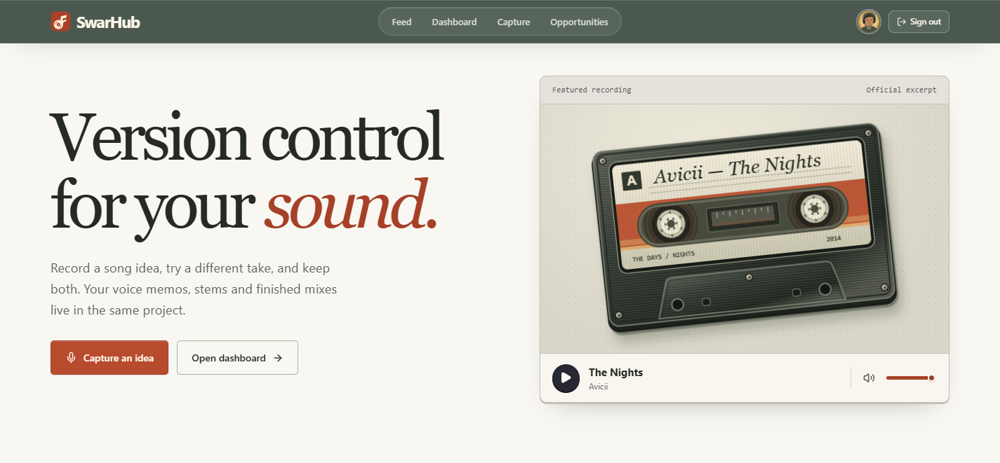

# SwarHub

**SwarHub is a browser-based recording studio for musicians who want to keep every version of a song.** Record a guitar riff, try a different chorus on a branch, then play the takes side by side to choose a master mix. The original recording stays in the project.



## Explore the studio

| Room | What you can do |
| --- | --- |
| Capture | Record a take with your microphone or import an audio file and listen back to a suggested excerpt. |
| Dashboard | Explore a project's take history, compare branches, and choose a master mix. |
| Feed | Browse the sample community feed and follow links to open music calls. |
| Opportunities | Filter manually curated gigs, jams, band openings, collaborations, and castings. Each card opens the original listing. |

## Tech stack

| Layer | Technologies | What they do in SwarHub |
| --- | --- | --- |
| Studio |    | Render the studio, navigate between rooms, and build the frontend. |
| Interface |    | Style the responsive layouts, animate the cards, and draw the controls. |
| Audio & local storage | 🎙️ Web Audio API · IndexedDB · localStorage | Analyse recordings on-device, store the audio in IndexedDB, and keep take history and mix selections in localStorage. |
| Account API |    | Serve accounts, projects, and audio versions. Passwords are hashed with bcrypt; authenticated requests use JWTs. |

## Project structure

```text
frontend/
├── public/                 Cassette audio, listing photos, and platform logos
└── src/
    ├── main.jsx            Active React entry point
    ├── lib/api.js          API client and account session helpers
    └── studio/
        ├── Studio.jsx        Routes, navigation, and shared workspace
        ├── Home.jsx          Home hero and listening desk
        ├── Capture.jsx       Microphone recording and file import
        ├── Dashboard.jsx     Project history, branches, and master mixes
        ├── Feed.jsx          Demo community feed
        ├── Portfolio.jsx     Artist profile and Opportunities page
        ├── opportunities.js  Curated listings and source links
        ├── audio.js          Decoding, analysis worker and WAV encoding
        ├── musicFeatures.js  Tempo and key estimators
        ├── signalProfile.js  Mix profile and highlight selection
        └── library.js        Local project and recording storage
backend/
├── server.js               Express endpoints
├── db.js                   SQLite initialization and schema
└── middleware/             JWT authentication
docs/
├── images/                 README screenshot
├── capture-analysis.md     Tempo, key, mix readings and benchmarks
├── capture-highlights.md   How the suggested excerpt is chosen
└── swarhub-graph.md        Routes, storage, and data flows
```

## Run locally

With Node.js 22.12+ and npm installed, run these commands from the repository root:

```sh
cd frontend
npm ci
npm run dev
```

Open the URL printed by Vite (usually `http://localhost:5173`). The studio preview works without the API; local recordings and project metadata stay in that browser.

### Optional backend

For the Express API, open another terminal in `backend/` and run `npm ci`. Generate a signing secret with `node -e "console.log(require('node:crypto').randomBytes(32).toString('hex'))"`. Save the result as `JWT_SECRET=<generated value>` in `backend/.env`, then start the API:

```sh
node --env-file=.env server.js
```

The API defaults to `http://localhost:3000` and initializes its SQLite database on startup. In a hosted deployment, supply `JWT_SECRET` through the environment.

## Development

- Run `npm run lint` and `npm run build` in `frontend/`.
- Run the analysis tests with `node --test src/__tests__/musicFeatures.test.js src/__tests__/signalProfile.test.js` in `frontend/`.
- Edit [`frontend/src/studio/opportunities.js`](frontend/src/studio/opportunities.js) to curate the board.
- See the [project map](docs/swarhub-graph.md) for routes, data flows, and storage, and [Capture analysis](docs/capture-analysis.md) for the measured accuracy and benchmark method.

## Project status

**Built**

- [x] Record or import audio, estimate tempo and key, and audition a short excerpt.
- [x] Branch takes, play layers together, and save a master selection without overwriting the originals.
- [x] Browse a sample community feed, edit a local artist profile, and feature projects.
- [x] Filter curated opportunities and open the original postings.
- [x] Sign up or log in with email and password through the optional API.

**Still to build**

- [ ] Connect Google sign-in and password recovery to working account flows.
- [ ] Sync browser-recorded takes, branch relationships, and mix selections across devices.
- [ ] Populate the community feed with activity from real accounts.
