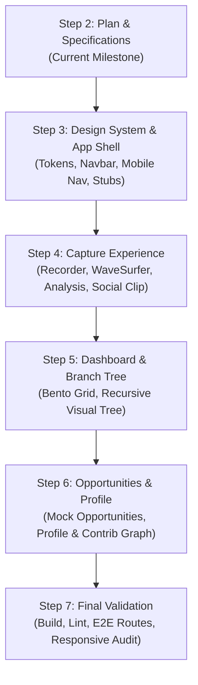

# SwarLab — Frontend Implementation Plan

> **Phase:** Frontend Only | **Status:** Approved Architecture Draft | **Date:** 2026-11-14

---

## 1. Architectural Guardrails (Frontend-First)

This phase operates strictly on the client layer without backend or database schema modifications:
- **Stack:** React 19 + Vite 8 + React Router v7 + Tailwind CSS v4 + Framer Motion + Lucide React + WaveSurfer.js + Axios.
- **Backend Stability:** Preserve all existing Express (`:3000`) contracts (`/signup`, `/login`, `/my-projects`, `/projects`, `/projects/:id/versions`, `/versions`, `/record`, `/branch`, `/analyze-audio`).
- **No Supabase / OAuth in this phase:** Authentication uses existing SQLite JWT contracts via `localStorage` (`access_token`, `user_id`).
- **No Automated Scraping:** Opportunities will be rendered using clearly designated, locally typed mock fixtures.
- **Data Honesty:** Audio analysis metadata is explicitly labeled as either real backend output or heuristic inference; no fake DSP signal results will be fabricated.

---

## 2. Route Architecture

### 2.1 Primary Application Routes
| Route | Component | Access | Description |
|---|---|---|---|
| `/` | `HomePage` | Public | Hero introduction, SwarLab mission, feature overview, CTA into Capture & Dashboard. |
| `/capture` | `CapturePage` | Public (Guest & Auth) | Audio recording, file upload, WaveSurfer preview, analysis metrics, social clip recommendation, project save. |
| `/dashboard` | `DashboardPage` | Protected | Bento grid of user projects, split-pane project inspector, visual Git-inspired branch tree. |
| `/opportunities` | `OpportunitiesPage` | Public | Filterable cards for music gigs, competitions, open calls, and grants (external links). |
| `/profile` | `ProfilePage` | Public / Hybrid | Musician profile card, guest conversion CTA, recent projects, contribution activity heatmap visualizer. |
| `/login` | `LoginPage` | Public | SwarLab styled authentication form. |
| `/signup` | `SignupPage` | Public | SwarLab styled user registration form. |

### 2.2 Backward-Compatibility Route Adapters
| Legacy Route | Target Behavior | Rationale |
|---|---|---|
| `/analyse` | Redirect or Render `CapturePage` | Existing bookmarks and in-flight links route directly to the new Capture experience. |
| `/compare` | Render legacy `ComparePage` with "In Development" banner | Preserves existing route without breaking navigation. |

---

## 3. Application Shell & Navigation

```
+---------------------------------------------------------------------------------------+
|  [Logo: SwarLab]    [Capture | Dashboard | Opportunities]       [Search]  [Avatar/Auth] |  <- Sticky Glass Pill
+---------------------------------------------------------------------------------------+
|                                                                                       |
|   <Main Content Container: max-w-6xl mx-auto px-4 sm:px-6 md:px-8 pt-24 pb-16>       |
|                                                                                       |
+---------------------------------------------------------------------------------------+
|  Mobile Drawer (<768px): Hamburger trigger -> sliding glass overlay with full nav    |
+---------------------------------------------------------------------------------------+
```

### 3.1 Shell Requirements
1. **Desktop Navbar (`NavBar.jsx`):**
   - Floating pill with `position: fixed`, `top-4`, `z-50`, centered (`max-w-6xl`).
   - Frosted glass effect (`rgba(17, 17, 24, 0.75)`, `backdrop-blur-md`, subtle `border-white/10`).
   - Active route highlighted with subtle studio violet pill (`#7C3AED`) and white text.
2. **Mobile Navigation (`MobileNav.jsx`):**
   - Hamburger button visible on `<md` screens.
   - Accessible slide-out glass drawer containing links to Capture, Dashboard, Opportunities, and Auth.
   - Traps focus and closes on route change or ESC key.
3. **User Action Pill (Top Right):**
   - **Guest:** "Sign In" button linking to `/login`.
   - **Authenticated:** Avatar circle with user initials / icon + dropdown for "Profile" (`/profile`) and "Logout".

---

## 4. Visual Design System (Dark Music Laboratory)

### 4.1 Token Specifications
```css
/* Core Theme Tokens */
--color-bg: #09090E;             /* Deepest nocturnal laboratory base */
--color-surface: #111118;        /* Base panel surface */
--color-surface-hover: #171722;  /* Elevated panel hover state */
--color-border: rgba(255, 255, 255, 0.08);
--color-border-hover: rgba(255, 255, 255, 0.16);

/* Accent System */
--color-primary: #7C3AED;        /* Studio Violet - Core branding & primary actions */
--color-primary-hover: #6D28D9;
--color-accent-metric: #38BDF8;  /* Sky Blue - Musical Key, analysis data, frequency tags */
--color-recording: #EF4444;      /* Vivid Red - Active recording indicator & pulse */
--color-success: #10B981;        /* Emerald - Success badges & active take nodes */
--color-warning: #F59E0B;        /* Amber - Mood, warnings, urgency deadlines */

/* Typography */
--font-sans: 'Inter', -apple-system, sans-serif;
--font-mono: 'JetBrains Mono', 'IBM Plex Mono', monospace; /* For BPM, Hz, IDs, timestamps */
```

### 4.2 Rules of Application
- **Bento Geometry:** Cards feature uniform `rounded-3xl` (24px) border radius with 1px border.
- **Glass Restraint:** Background blur is strictly layered on elevated components; no blurry text or low-contrast backgrounds.
- **Monospace Precision:** Musical values (e.g. `124 BPM`, `440 Hz`, `00:32.4`) always render in `--font-mono`.
- **Accessibility & Motion:**
  - Minimum contrast ratio of 4.5:1 for all text.
  - Distinct `outline: 2px solid var(--color-primary)` focus rings for keyboard users.
  - `@media (prefers-reduced-motion)` disables heavy transforms, substituting clean opacity transitions.

---

## 5. Phased Execution Roadmap (Frontend)


