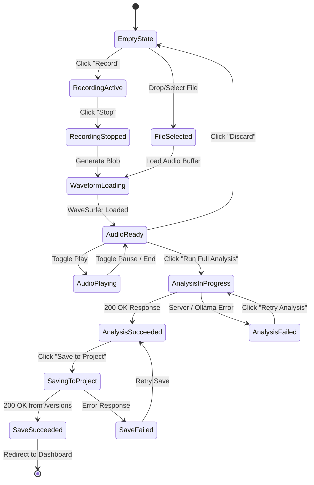

# SwarLab — Frontend State Taxonomy & Data Honesty Specifications

> **Phase:** Frontend Only | **Status:** Approved Specification | **Date:** 2026-11-14

---

## 1. Global Authentication & User States

| User State | Condition | UI Behavior & Access |
|---|---|---|
| **Guest User** | No `access_token` in `localStorage` | Unrestricted access to `/`, `/capture`, `/opportunities`, and `/profile` (guest view). Prominent "Sign In" button in top-right navbar. If the user attempts to persist a project from Capture or access `/dashboard`, a friendly modal prompts them to log in or create an account to save their work permanently. |
| **Authenticated User** | Valid `access_token` in `localStorage` | Full access across all routes including `/dashboard`. Top-right navbar displays user initials / avatar with a dropdown menu linking to `/profile` and `Logout`. |

---

## 2. Capture Page State Machine

### Detailed State Specifications

1. **Empty State:**
   - Display: Dual action area (large record button with mic icon + drag-and-drop file target).
   - Video upload slot displayed with "Video Analysis Coming Soon" badge.
   - Analysis panel is hidden; placeholder message "Waiting for audio input..." displayed in waveform preview.
2. **Recording Active:**
   - Pulsing red recording dot (`var(--color-recording)`), elapsed timer counting in monospace (`00:04.2`), and "STOP RECORDING" button.
   - Microphone stream active via `MediaRecorder`.
3. **Recording Stopped / File Selected:**
   - Audio blob instantiated in memory; recording stops and mic tracks are released.
4. **Waveform Loading:**
   - Shimmer placeholder inside the waveform container while `WaveSurfer.js` initializes audio peaks.
5. **Audio Ready & Playing:**
   - Interactive waveform rendered with play/pause button, total duration and current time indicators.
   - Discard button (trash icon) to clear memory and return to Empty State.
   - Prominent primary CTA: "Run Full Analysis".
6. **Analysis in Progress:**
   - CTA changes to disabled state with spinning loader: "Analyzing Audio Intelligence...".
   - Subtle pulse animation over the analysis container.
7. **Analysis Succeeded:**
   - Bento grid renders 6 metric cards: Tempo, Scale Key, Mood, Genre, Detected Instruments, Frequency Range.
   - **Data Honesty Tag:** Explicit `InferenceBadge` stating: *"AI Inferred (Text/Heuristic) — Audio DSP verification offline"*.
   - **Best Social Clip Recommendation:** Visual highlight banner showing recommended 15s–30s snippet with time markers (`00:15` to `00:45`).
   - "Save to Project" CTA unlocked.
8. **Analysis Failed:**
   - Red status banner displayed: *"Audio analysis failed. Backend or Ollama service is unavailable."*
   - "Retry Analysis" button rendered.
9. **Saving to Project (Modal):**
   - Modal queries `GET /my-projects`.
   - Guest: Displays callout *"Sign in to save permanently to your cloud dashboard"*.
   - Authenticated: Lists user projects + allows selecting a destination repository.
10. **Save Succeeded / Save Failed:**
    - Succeeded: Green checkmark banner; smooth auto-redirect to `/dashboard` after 1.5s.
    - Failed: Descriptive error message without closing modal, enabling retry.

---

## 3. Dashboard State Machine

| Dashboard State | Trigger / Condition | Visual Representation |
|---|---|---|
| **Loading Projects** | Initial `GET /my-projects` in-flight | 4 shimmering skeleton cards in bento grid. |
| **No Projects (Empty)** | Projects array is empty (`[]`) | Illustrated empty box with "No projects found" and a prominent "Create Your First Project" button. |
| **Project List View** | Projects loaded successfully | Bento cards displaying project title, ID, visibility badge (Public/Private), and commit count. Search bar filters cards live by title. |
| **Project Selected (Inspector)** | User clicks a project card | Split-pane opens: Left pane shows project metadata; Right pane queries `GET /projects/:id/versions` to render version history. |
| **Loading Versions** | Version fetch in-flight | Spinner with "Loading Repository Branches...". |
| **No Versions** | Version list is empty | Graphic indicating "No branches or versions committed yet. Go to Capture to add your first take." |
| **Branch Tree Active** | Versions array contains items | Hierarchical tree rendered using `BranchTree.jsx`. Root takes connect to child instrument branches. |
| **Branch Node Selected** | User clicks a specific take node | Details drawer reveals node's BPM, Key, timestamp, and audio play button (`GET /audio/:filename`). |
| **Branch Expanded / Collapsed** | User toggles "View Branches (N)" | Smooth height transition expanding child takes linked by `parent_id`. |
| **Create Branch Take Modal** | User clicks "+ Add Instrument Layer" | Dialog allowing recording/uploading a take attached to the active branch node. |

---

## 4. Opportunities Page State Machine

| State | Condition | Presentation |
|---|---|---|
| **Loading** | Initial load | 6 skeleton bento cards. |
| **Active Cards** | Opportunities loaded | Grid of opportunity cards with category badges (Gigs, Competitions, Grants, Collabs), platform logo, short description, and deadline urgency badge. |
| **Filtered Empty** | Selected category filter returns 0 cards | "No opportunities found in this category" with a button to "Reset Filters". |
| **Apply Trigger** | User clicks "Apply on [Platform] ->" | Secure external link opens target URL in a new tab with `rel="noopener noreferrer"`. |

---

## 5. Profile Page State Machine

| State | Condition | Presentation |
|---|---|---|
| **Guest Profile** | No active session | Clean card showing avatar placeholder and an inviting banner: *"You are browsing as a Guest. Create an account to permanently sync your projects and track your daily musical creations."* Includes quick buttons to "Log In" or "Sign Up". |
| **Authenticated Profile** | Active session with `user_id` | Displays user avatar circle, handle/email, bio, quick stats (Total Projects, Total Takes), and the recent projects row. |
| **Contribution Graph** | All states | 52-week GitHub-style heatmap illustrating creation momentum. Clearly indicated as a visual activity visualizer during frontend development. |

---

## 6. Error & Network State Taxonomy

| Error Type | Visual Indicator | User Remediation |
|---|---|---|
| **401 Unauthorized** | Global interceptor detects expired/invalid JWT | Clears `localStorage` and smoothly redirects to `/login` with an informational toast. |
| **Network Disconnected** | Browser `offline` event triggered | Sticky amber top-bar alert: *"Offline mode — audio playback works locally, but cloud saving requires internet"*. |
| **API Error (500 / 404)** | Inline red notification box | Displays specific backend message if available or fallback *"Server error. Please verify backend is running on port 3000."* |

---

## 7. Data Honesty Matrix (Real vs. Mock)

To prevent any misleading claims regarding AI capabilities and persistence during development:

| Domain | Feature | Current Backend Reality | Frontend Transparency Contract |
|---|---|---|---|
| **Capture Analysis** | BPM, Key, Mood, Genre, Instruments | Backend uses Ollama text prompt or static fallback; true DSP audio frequency analysis is currently offline. | Must display an explicit `InferenceBadge`: *"Inferred Metadata (Ollama/Heuristic)"*. Do NOT represent fallback data as verified audio DSP. |
| **Capture Social Clip** | "Best Short Clip" recommendation | Backend currently does not return audio segment markers. | Frontend uses a deterministic duration calculation (peak 30s window based on track length) and labels it *"Recommended Clip Highlight (Calculated)"*. |
| **Opportunities** | Competitions & Gigs list | Backend currently has no live scraping engine. | Stored in an explicitly named local fixture file: `frontend/src/data/mockOpportunities.js`. Must be labeled as curated fixtures. |
| **Profile Activity** | 52-Week Contribution Graph | Backend currently has no `activity_logs` table. | Labeled as *"Activity Momentum (Visualizer Preview)"*. Does not claim permanent database tracking until backend supports it. |
| **Guest Persistence** | Guest project saving | Backend requires `user_id` foreign key. | Does not claim guest projects persist across browser sessions. Prompts user to authenticate to guarantee permanent cloud storage. |
