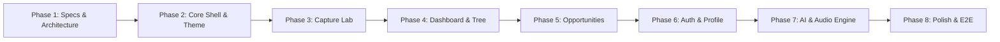

# SwarLab — Phased Implementation Roadmap

> **Version:** 1.0 | **Status:** Active Planning | **Date:** 2026-11-14

---

## Overview & Execution Strategy

SwarLab is built using structured, wave-based **GSD (Get Shit Done)** iterations. Each phase is delivered as an atomic milestone followed by automated verification and human alignment before proceeding.

---

## Phase Breakdown

### Phase 1: Planning & Architecture (Current Milestone)
- [x] Extract repository structure & build local AST graph via Graphify.
- [x] Draft comprehensive Product Requirements Document (`PRD.md`).
- [x] Map system architecture, data models, and migration path (`architecture.md`).
- [x] Establish design tokens, glassmorphism rules, and component system (`design.md`).
- [x] Define autonomous agent operation rules & skill assignments (`agent.md`).
- [x] Outline multi-tier testing strategy with Playwright & Vitest (`test.md`).
- [x] Rebrand root project documentation to SwarLab (`README.md`).
- [ ] Align with human partner on architectural decisions and backend remediation plan.

---

### Phase 2: Global Shell, Navigation & Theme System
**Objective:** Replace legacy top bar with the modern dark laboratory aesthetic, unified routing, and glass pill navigation.

- **Tasks:**
  1. Configure Tailwind token aliases matching the design system (`#09090E` background, `#7C3AED` primary violet, `#38BDF8` sky blue, glass utilities).
  2. Implement global navigation shell (`NavBar.jsx`) with 3 primary items:
     - **Capture** (`/capture`)
     - **Dashboard** (`/dashboard`)
     - **Opportunities** (`/opportunities`)
     - Profile / Auth indicator (top-right pill)
  3. Wire client-side routes with React Router v6 and clean page stubs.
  4. Ensure mobile drawer navigation (<768px) and responsive containers.
- **Verification:**
  - Build succeeds (`npm run build`).
  - Viewport tests at 375px and 1280px show seamless sticky pill navigation and glass backdrop blur.

---

### Phase 3: Capture Experience (Record, Upload & Analysis Card)
**Objective:** Allow seamless, zero-auth audio/video recording or file drop with instant musical analysis feedback.

- **Tasks:**
  1. Build `Recorder.jsx` with real-time waveform canvas visualizer (Web Audio API oscilloscope).
  2. Implement drag-and-drop file uploader for audio/video formats (`.mp3`, `.wav`, `.m4a`, `.webm`, `.mp4`).
  3. Create `AnalysisPanel.jsx`:
     - Visual metrics: BPM badge, Musical Key dial, Mood tag, Genre pill, Energy frequency spectrum.
  4. Create `BestClipCard.jsx`:
     - Highlight 15s–30s snippet recommendation optimized for social media reels/TikTok with waveform highlight.
  5. Provide "Save into Project" modal prompting title and project assignment (works in guest/anonymous mode via local storage or saved to DB if logged in).
- **Verification:**
  - Microphone capture generates live audio waveform.
  - Test file drop triggers analysis state and transitions to results panel without page reload.

---

### Phase 4: Dashboard & Git-Inspired Branch Tree
**Objective:** Multi-layered visual project hierarchy (Project → Main Take → Instrument Layers).

- **Tasks:**
  1. Rebuild Dashboard view with Bento grid layout showcasing projects with badges (total layers, genre, latest activity).
  2. Implement split-pane project view:
     - Left: Project metadata, commit stats, export actions.
     - Right: Interactive visual branch tree (`BranchTree.jsx`).
  3. Branch Tree capabilities:
     - Interactive SVG/Canvas node rendering with branch connections.
     - Color-coded nodes by instrument type (Vocals = Amber, Drums = Emerald, Guitar = Violet, Bass = Cyan).
     - Inline audio preview player when a node is selected.
     - "Branch from this take" action to stack additional layers.
- **Verification:**
  - Creating a branch links correctly to `parent_id` in database.
  - Tree expands/collapses smoothly and preserves layout hierarchy across up to 20 nodes.

---

### Phase 5: Opportunities Portal
**Objective:** Curated cards for music competitions, gigs, festival open calls, and grants.

- **Tasks:**
  1. Build `/opportunities` page with category filters (All, Gigs, Competitions, Grants, Collabs).
  2. Implement responsive bento cards:
     - Platform indicator (Unstop, Soundcloud, IndieWire, etc.).
     - Deadline countdown badge (color-coded urgency).
     - Direct "Apply" external link with security attributes (`rel="noopener noreferrer"`).
  3. Static dataset seeded via backend API with fallback mock data.
- **Verification:**
  - Filter pills dynamically filter opportunity cards without latency.
  - External links open target sites correctly.

---

### Phase 6: Authentication & User Profile
**Objective:** Transition seamlessly from guest usage to permanent cloud persistence.

- **Tasks:**
  1. Setup Supabase Auth / JWT authentication flow (Email/Password + Google OAuth).
  2. Secure token handling:
     - Store access token in memory/Zustand store; handle token refresh via secure cookies.
     - Eliminate insecure hardcoded secrets (`JWT_SECRET = 'secret123'`).
  3. Build User Profile view (`/profile`):
     - User avatar, handle, and editable bio.
     - Carousel / list of user's 4–5 recent active projects.
     - GitHub-style 52×7 contribution activity heatmap (`ContribGraph.jsx`) logging captures, branches, and commits.
- **Verification:**
  - Google OAuth login and email/password signup create associated profile records.
  - Protected API endpoints reject unauthorized calls with 401/403.

---

### Phase 7: Backend Hardening & AI Audio Pipeline
**Objective:** Stabilize backend services, decouple local Ollama dependency, and refine audio analysis.

- **Tasks:**
  1. Remove hardcoded secrets and exposed debug routes (`/debug/tables`, `/debug/users`).
  2. Secure `/recordings/:id` with strict ownership checks.
  3. Implement robust audio feature extraction pipeline:
     - Librosa/Python microservice or structured Gemini multimodal audio analysis.
     - Deterministic BPM, key detection, and dynamic social clip extraction.
  4. Add file type and payload size validation on Multer middleware.
- **Verification:**
  - Automated integration tests pass with mock AI fixture.
  - Security audit with VibeSec shows zero high-severity vulnerabilities.

---

### Phase 8: Production Polish, Responsive Audit & E2E Testing
**Objective:** Ship a battle-tested, high-performance web experience.

- **Tasks:**
  1. Full responsive audit across mobile (375px), tablet (768px), and desktop (1280px+).
  2. Run Playwright E2E suite covering:
     - Anonymous Capture journey
     - Sign-up & Project creation
     - Branch creation & playback
     - Opportunities filtering
  3. Performance optimization (Lighthouse score ≥ 85, lazy loading, audio buffer management).
- **Verification:**
  - All Playwright test specs succeed in headless CI mode.
