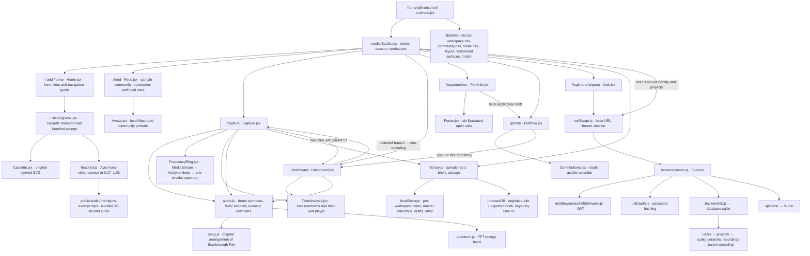

# SwarHub · project knowledge graph

Start here for the active application. Follow the relevant edge to its source; the [previous generated graph](../graphify-out/GRAPH_REPORT.md) covers the older UI, tooling and supporting documents. The two graph views describe different revisions. Dependencies, recordings, the SQLite contents and generated bundles are not source nodes.

The [machine-readable source graph](swarhub-graph.json) indexes first-party modules, local imports and HTTP endpoints. `active-frontend` marks modules reachable from the live React entry. Regenerate after source topology changes with `node docs/build-source-graph.mjs`.

**Working boundaries**

| Question | Start at | Contract |
|---|---|---|
| How do I run it? | `frontend/package.json`, `frontend/vite.config.js` | From `frontend`, `npm run dev` or `npm run build`. Production hosting needs SPA fallback to `index.html`. |
| Where are takes saved? | `studio/Capture.jsx`, `studio/library.js` | The save dialog requires a name and visibility for a new project. A branch inherits its project's visibility; mood is optional. Metadata stays browser-local and a fork shares immutable media references. |
| Why is a tempo or key different? | `studio/audio.js` | On-device onset correlation, pitch-class estimates and a rolling energy window; not a hosted AI model. The short preview is at most 15 seconds. |
| How does a merge work? | `studio/Dashboard.jsx` | A master mix stores a set of take IDs, leaving recordings intact. Stem playback uses the selected audio sources together. |
| Which pages need an API? | `studio/Studio.jsx`, `src/lib/api.js` | Signup/login, `/me`, `/my-projects`, `/projects/:id/versions`; default API `http://localhost:3000`, overridable via `VITE_API_URL`. Account versions have no stored parent relationship. |
| Where do Google sign-in and recovery go? | `studio/Auth.jsx` | `VITE_GOOGLE_LOGIN_URL` points to the deployment’s OAuth initiation endpoint and `VITE_ACCOUNT_RECOVERY_URL` to its recovery page. Without them the UI explains the preview limitation. |
| Why does the hook stop early? | `studio/audio.js`, `studio/TakeAnalysis.jsx` | The hook is a separate WAV containing only the detected interval. Its bounds are trimmed within a maximum 15-second energy window. The full-take player uses the original audio. |
| How does the artist preview work? | `studio/Studio.jsx`, `studio/Portfolio.jsx` | A fresh tab shows preview avatar and sign-out controls without an auth token. Signing out switches to Log in / Sign up for that tab. Real accounts take precedence. |
| How do I open the demo profile directly? | `studio/Studio.jsx` | `/preview/profile` explicitly reopens the tab’s preview artist session and redirects to `/profile`, including after a previous sign-out. An existing authenticated account keeps its own identity. |
| Where does the Home excerpt come from? | `studio/ListeningDesk.jsx`, `studio/featured.js`, `public/audio/` | The cassette plays a bundled 46-second MP3 taken from the 0:17–1:03 section of the linked Avicii lyric video, so it does not depend on YouTube availability at runtime. `VITE_FEATURED_AUDIO_URL` can replace the file for a licensed deployment. The footer credit links to the source video. |
| How do project details open? | `studio/Dashboard.jsx`, `studio/TakeAnalysis.jsx` | `/dashboard` lists repositories; `?project=<id>&take=<id>` opens the project and selected take. Adding a branch to a remote project creates a local working copy. |
| Is a portfolio or brief live? | `studio/Portfolio.jsx` | Portfolio selection and example brief drafts are local. No artist is contacted and no application is transmitted. Opportunities can save a local draft, but the profile deliberately does not list applications. |
| What about the older architecture? | `graphify-out/graph.json`, `docs/architecture.md` | `src/App.jsx`, `src/components/`, `src/pages/` are the previous frontend, outside the active import tree. Backend recording/tagging routes are separate from the new local capture path. |

Keep this map in sync when an entry point, route, storage owner or API contract changes. For implementation details, inspect the named source rather than rescanning the repository.
