# SwarHub · project knowledge graph

Start here for the active application. Follow the relevant edge to its source. Dependencies, recordings, the SQLite contents and generated bundles are not source nodes.

## Current handoff

- Logo verification: `node frontend/scripts/testBranding.mjs` passed in Chrome; frontend lint and production build passed.
- Dashboard starts empty. Saving a recording or upload creates a dated card; discarding does not. `library.js` removes old demo takes while retaining real branches. Delete remains on the project detail page.
- `Dashboard.jsx` → `projectCovers()` → `frontend/public/art/projects/`: twelve licensed Pexels photos, assigned across the full recorded library before filtering. Use every photo before recycling the set. Opportunities has its own separate images.
- Capture includes the responsive analysis guide and the revised key estimator. See `docs/capture-analysis.md` for the method and its evaluation.
- Accounts now use Supabase Auth: email signup with confirmation and resend, password login, local sign-out, and Google OAuth through `/auth/callback`. The signed-in workspace key is `supabase-<user id>`. A fresh visitor is signed out by default; `/preview/profile` still opens the demo artist.
- `claimGuestLibrary()` in `library.js` copies the guest shelf into the first account that signs in on a browser (`swarhub:guest-claimed` prevents repeats) and shows a dismissible notice. The guest copy is retained for sign-out.
- Setup lives in `README.md` → *Accounts with Supabase* and `frontend/.env.example`. Required: `VITE_SUPABASE_URL`, `VITE_SUPABASE_PUBLISHABLE_KEY`; optional: `VITE_GOOGLE_AUTH_ENABLED`. Keep `VITE_AUTH_PROVIDER=legacy` only for the Express/SQLite accounts.
- Local `frontend/.env` targets the configured Supabase project and is gitignored. Supabase reports email enabled, signup open, confirmation required (`mailer_autoconfirm:false`), and Google disabled. Google needs a Google Cloud OAuth client and provider setup; `Auth.jsx` then auto-detects the enabled provider via `/auth/v1/settings`, or `VITE_GOOGLE_AUTH_ENABLED=true` forces the button.
- Supabase holds identity and sessions. Recordings and project history remain browser-local; syncing them to Supabase Storage/Postgres is not implemented.
- Security pass: removed the unauthenticated `/debug/users` and `/debug/tables` routes; `/versions`, `/upload`, `/record`, `/branch`, `/analyze-*`, and `DELETE /recordings/:id` now require a JWT and are scoped to the token's user. JWT verification is pinned to HS256. Login/signup are rate limited, uploads are audio-only with a 25 MB cap and UUID filenames, CORS uses `CORS_ORIGINS`, and the API sets `nosniff`/frame/referrer headers. `frontend/public/_headers` adds CSP and related headers for static hosts.
- Profile photos: `profilePhoto.js` centre-crops, resizes to 512 × 512, re-encodes as JPEG (dropping EXIF/GPS) and caps the stored string at 400 KB. `Portfolio.jsx` stores `artist.photo` in the local workspace; the header avatar and profile portrait render it only after `safePhoto()` validates a `data:image/` URL.
- Brand mark: `frontend/public/art/swarhub-mark.png` is a 512 x 512 transparent PNG rebuilt from the supplied image. `index.html` uses it as the favicon, `Auth.jsx` as the auth-card mark, and `Studio.jsx` as the nav mark, recoloured with `filter:brightness(0) invert(1)` on the dark glass nav. The old `swarhub-mark.svg` was removed.
- Verified: `node frontend/scripts/testAuthBrowser.mjs` passed against the real Supabase client with mocked auth endpoints (signup, resend, PKCE callback, guest-library claim, reload, sign-out, failed and successful password login, Google PKCE). `node frontend/scripts/testSupabaseLive.mjs` passed against the live project: signup form enabled, Google hidden, and the real auth endpoint returned `Invalid login credentials` for a deliberate wrong password. `testProjectControls.mjs`, `testCaptureBrowser.mjs`, the 18 analysis tests, lint, and build passed. `node frontend/scripts/testSecurityBrowser.mjs` passed URL tampering, cross-account isolation, stored-XSS escaping, and unsafe-link rejection. `node frontend/scripts/testProfilePhoto.mjs` passed upload, crop, persistence, rejection, and removal. `node frontend/scripts/testSecrets.mjs` passed with 304 tracked files and no local credentials. `npm test` in `backend/` passed 9 security tests.
- Resume: password reset is the next account feature. Start any new task with a focused Graphify query as described in `AGENTS.md`.

The [machine-readable source graph](swarhub-graph.json) indexes first-party modules, local imports and HTTP endpoints. `active-frontend` marks modules reachable from the live React entry. Regenerate after source topology changes with `node docs/build-source-graph.mjs`.

```mermaid
flowchart TD
  entry["frontend/index.html → src/main.jsx"] --> shell["studio/Studio.jsx · router, session, workspace"]
  entry --> css["studio/studio.css, workspace.css, community.css, home.css, opportunities.css · layout, instrument surfaces, motion"]
  shell --> home["/ and /home · Home.jsx · hero, idea and navigation guide"]
  shell --> feed["/feed · Feed.jsx · sample community repositories and local stars"]
  shell --> capture["/capture · Capture.jsx"]
  shell --> dashboard["/dashboard · Dashboard.jsx"]
  shell --> calls["/opportunities · Portfolio.jsx · curated open calls and source directory"]
  shell --> artist["/profile · Portfolio.jsx"]
  shell --> auth["/login, /signup and /auth/callback · Auth.jsx"]
  entry -->|favicon| mark["public/art/swarhub-mark.png"]
  shell -->|navigation| mark
  auth -->|account pages| mark
  auth --> supa["lib/supabase.js · Supabase client, PKCE, Google flag"]
  supa --> hosted["Supabase Auth → Postgres · users, sessions, email, Google OAuth"]
  home --> desk["ListeningDesk.jsx · cassette transport and bundled excerpt"]
  desk --> tape["Cassette.jsx · original layered SVG"]
  desk --> featured["featured.js · Avicii lyric-video excerpt at 0:17–1:03"]
  featured --> audiofile["public/audio/the-nights-excerpt.mp3 · bundled 46-second audio"]
  feed --> avatar["Avatar.jsx · local illustrated community portraits"]
  capture --> sound["audio.js · demo synthesis, WAV encoder, acoustic estimates"]
  capture --> ring["FrequencyRing.jsx · MediaStream → AnalyserNode → one circular spectrum"]
  sound --> song["song.js · original arrangement of Scarborough Fair"]
  sound --> spectrum["spectrum.js · FFT energy band"]
  capture --> analysis["TakeAnalysis.jsx · measurements and best-part player"]
  dashboard --> analysis
  dashboard --> covers["projectCover.js → public/art/projects · Dashboard photographs"]
  calls --> data["opportunities.js · hand-checked calls and nine sources"]
  calls --> marks["public/art/platforms · nine local platform marks"]
  artist --> activity["Contributions.jsx · studio activity calendar"]
  artist --> photo["profilePhoto.js · crop, resize and EXIF strip"]
  capture --> sound
  dashboard --> sound
  capture --> library["library.js · scoped library, demo migration and audio storage"]
  shell --> library
  library --> local["localStorage · per-workspace takes, master selections, drafts, artist"]
  library --> blobs["IndexedDB · original audio + exported hook, keyed by take ID"]
  photo --> local
  capture -->|"new take with parent ID"| dashboard
  dashboard -->|"selected branch → new recording"| capture
  calls -->|"external source link"| sources["BandMate, MyRangManch, StarClinch and six more"]
  artist -->|"open or fork repository"| dashboard
  auth -->|"only when VITE_AUTH_PROVIDER=legacy"| api["src/lib/api.js · base URL, bearer session"]
  shell -->|"legacy: read account identity and projects"| api
  api --> server["backend/server.js · Express"]
  server --> guard["middleware/authMiddleware.js · JWT"]
  server --> limit["middleware/rateLimit.js · login and signup limits"]
  server --> hash["utils/auth.js · password hashing"]
  server --> db["backend/db.js → database.sqlite"]
  server --> files["uploads/ → /audio"]
  db --> tables["users → projects → audio_versions; recordings → parent recording"]
```

**Working boundaries**

| Question | Start at | Contract |
|---|---|---|
| How do I run it? | `frontend/package.json`, `frontend/vite.config.js` | From `frontend`, `npm run dev` or `npm run build`. Production hosting needs SPA fallback to `index.html`, including `/auth/callback`. |
| How do accounts work? | `lib/supabase.js`, `studio/Auth.jsx`, `studio/Studio.jsx` | Supabase Auth owns accounts, email confirmation, sessions, and Google. `Studio.jsx` restores the session before rendering and keys the local workspace by user ID. The publishable key may ship; the secret/service-role key must not. Setup steps are in `README.md`. |
| What happens to guest recordings after signup? | `studio/library.js`, `studio/Studio.jsx` | `claimGuestLibrary()` copies the guest shelf into the first account that signs in on that browser and marks `swarhub:guest-claimed`. The guest copy remains for sign-out; no server upload occurs. |
| How are profile photos stored? | `studio/profilePhoto.js`, `studio/Portfolio.jsx` | The browser centre-crops the chosen image, resizes it to 512 × 512, re-encodes it as JPEG (removing EXIF/GPS) and stores it as `artist.photo` in the workspace. `safePhoto()` rejects anything that is not a bounded `data:image/…` value before it reaches an ``. |
| How is the app hardened? | `frontend/public/_headers`, `backend/middleware`, `backend/server.js` | CSP and security headers ship for hosts that read `_headers`. The API requires a JWT for every recording route, scopes rows by `user_id`, pins HS256, rate limits credentials, validates and caps uploads, and restricts CORS with `CORS_ORIGINS`. `testSecrets.mjs` fails if a tracked file contains a local credential. |
| Where are takes saved? | `studio/Capture.jsx`, `studio/library.js` | The save dialog requires a name and visibility for a new project. A branch inherits its project's visibility; mood is optional. Metadata stays browser-local and a fork shares immutable media references. |
| Why is a tempo or key different? | `studio/audio.js` | On-device onset correlation, pitch-class estimates and a rolling energy window; not a hosted AI model. The short preview is at most 15 seconds. |
| How does a merge work? | `studio/Dashboard.jsx` | A master mix stores a set of take IDs, leaving recordings intact. Stem playback uses the selected audio sources together. |
| Which pages need an API? | `studio/Studio.jsx`, `src/lib/api.js` | Only the legacy path: signup/login, `/me`, `/my-projects`, `/projects/:id/versions`; default `http://localhost:3000`, overridable via `VITE_API_URL`. Account versions have no stored parent relationship. |
| Where does Google sign-in go? | `studio/Auth.jsx`, `lib/supabase.js` | Google OAuth runs through Supabase PKCE and returns to `/auth/callback`, which the client exchanges for a session. The auth page reads the public `/auth/v1/settings` and shows the button when Google is enabled; `VITE_GOOGLE_AUTH_ENABLED=true` forces it. Legacy `VITE_GOOGLE_LOGIN_URL` is still honoured in legacy mode. Password recovery is not built yet. |
| Why does the hook stop early? | `studio/audio.js`, `studio/TakeAnalysis.jsx` | The hook is a separate WAV containing only the detected interval. Its bounds are trimmed within a maximum 15-second energy window. The full-take player uses the original audio. |
| How does the artist preview work? | `studio/Studio.jsx`, `studio/Portfolio.jsx` | A fresh visitor is signed out and sees Log in / Sign up. `/preview/profile` opts that tab into the demo artist; sign-out clears the opt-in. Real accounts take precedence. |
| How do I open the demo profile directly? | `studio/Studio.jsx` | `/preview/profile` explicitly reopens the tab’s preview artist session and redirects to `/profile`, including after a previous sign-out. An existing authenticated account keeps its own identity. |
| Where does the Home excerpt come from? | `studio/ListeningDesk.jsx`, `studio/featured.js`, `public/audio/` | The cassette plays a bundled 46-second MP3 taken from the 0:17–1:03 section of the linked Avicii lyric video, so it does not depend on YouTube availability at runtime. `VITE_FEATURED_AUDIO_URL` can replace the file for a licensed deployment. The footer credit links to the source video. |
| How do project details open? | `studio/Dashboard.jsx`, `studio/TakeAnalysis.jsx` | `/dashboard` lists repositories; `?project=<id>&take=<id>` opens the project and selected take. Adding a branch to a remote project creates a local working copy. |
| Where do opportunities come from? | `studio/opportunities.js`, `studio/Portfolio.jsx`, `public/art/platforms` | The board is hand-curated from public Indian music platforms. Each card keeps SwarHub's own one-line summary and links to the original post; no listing text is copied and no application is transmitted. Platform marks are stored locally so the page never hotlinks a remote favicon. Re-check links and the `checkedAt` date before shipping. |
| Is a portfolio live? | `studio/Portfolio.jsx` | Portfolio selection is local. No artist is contacted and no application is transmitted. The profile deliberately does not list applications. |
| What about the older architecture? | `graphify-out/graph.json`, `docs/architecture.md` | `src/App.jsx`, `src/components/`, `src/pages/` are the previous frontend, outside the active import tree. Backend recording/tagging routes are separate from the new local capture path. |

Keep this map in sync when an entry point, route, storage owner or API contract changes. For implementation details, inspect the named source rather than rescanning the repository.
